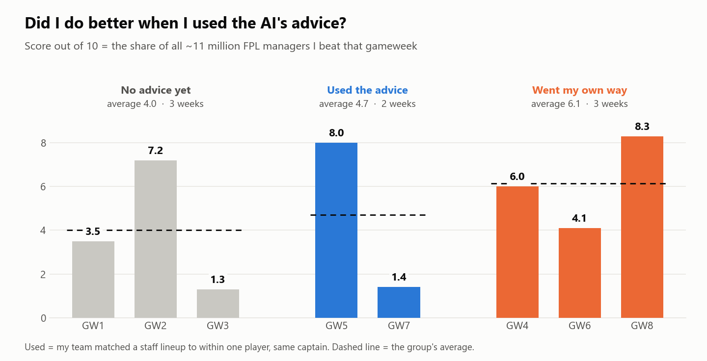
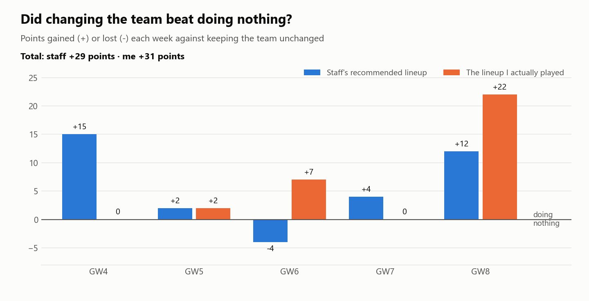
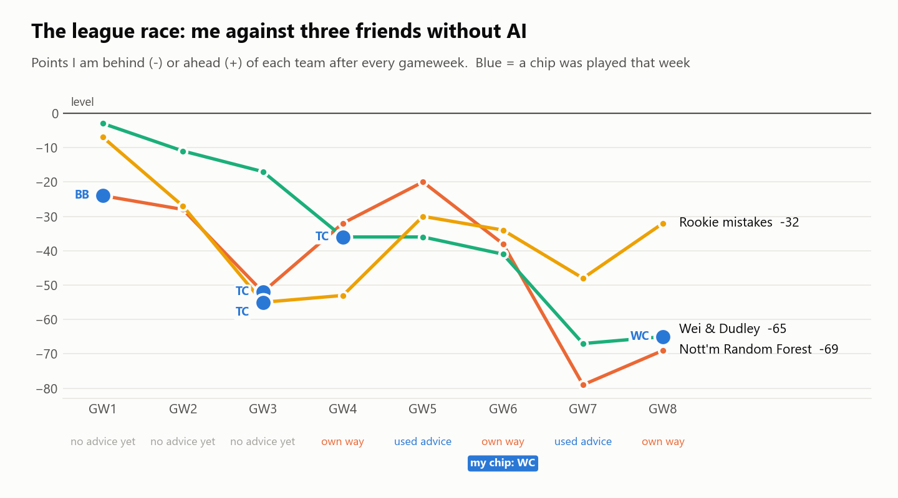
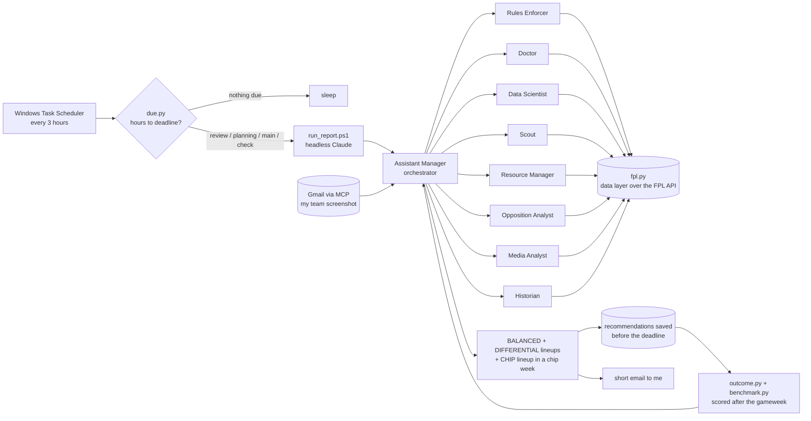

# A Multi-Agent AI Staff for Fantasy Premier League

**Can a team of AI agents help me improve in FPL?**

Every gameweek in Fantasy Premier League (FPL) brings the same decisions: which 11 of my 15 players start, who is captain, whether to make transfers, and when to play a chip.  
I play in a four-manager league with friends.  
Instead of deciding alone, I built a **multi-agent AI system** that works like a real football staff.  
Before every deadline, nine LLM agents read live data, argue, and email me two lineups.  
**The AI only advises; I make every change myself.**

The system runs by itself through the season, and every recommendation is checked against what actually happened.  
That way the question above gets a measured answer instead of a feeling.

## Findings

<!-- RESULTS:START -->
*Updated after GW8. The AI staff started advising in GW4.*

### 1. Did I do better when I used the AI's advice?

Weeks I used the advice: **4.7/10** on average (2 weeks).  
Weeks I went my own way: **6.1/10** (3 weeks).  
Before there was any advice: **4.0/10**.  
With this few weeks, one good or bad week moves an average a lot.

### 2. Does the advice beat doing nothing?

Over GW4-8 the staff's recommended lineups scored **272** points against **243** for doing nothing (**+12%**).  
My own choices, made after reading the advice, scored **274**.

### 3. The league race

The goal is to beat three friends who play without AI.  
Since the staff started: **Nott'm Random Forest** -52 → -69, **Wei & Dudley** -17 → -65, **Rookie mistakes** -55 → -32.  
Blue points mark the weeks a chip was played, because a chip can swing a week on its own.

### 4. Can the staff predict their own results?

*Coming soon - tracked from GW9.*  
Before every deadline the staff now record the points they expect, with a best and worst case.  
This section will compare each forecast with the real score.

### 5. Do we reach the goals we set?

*Coming soon - from GW10.*  
Each planning run sets two checkable goals for the week, for example "close 5 points on a rival" or "beat the top-100 average".  
The review marks each one met or missed, and the record will appear here.
<!-- RESULTS:END -->

## How it works

Everything is timed from the **deadline**, not the weekday, because some deadlines fall midweek.  
A scheduler wakes every 3 hours.  
A small Python file (`due.py`, no AI) decides whether one of four runs is due:

| Run | When | What it does |
|---|---|---|
| **Review** | once the gameweek's data is final | scores last week's advice against what happened and updates the season plan |
| **Planning** | 4 to 2 days before | chip timing, the season plan, the expected moves of the three rivals, and two checkable goals for the week |
| **Main** | about 1 day before | reads my emailed team through the **Gmail MCP connector**, runs the staff meeting, and emails two lineups (three in a chip week) |
| **Check** | last 8 hours | re-checks fitness and whether the report really arrived; silent unless something is wrong |

Each run starts Claude **headlessly** (`claude -p`, no chat window, nobody watching).  
It does the work and emails me the result.

### The staff

Each agent is one file in [`.claude/agents/`](.claude/agents/) that sets its role, the tools it may use and its model.  
The orchestrator runs on Claude Fable and the specialists on Claude Opus.

| Agent | How it does its job |
|---|---|
| **Assistant Manager** | The orchestrator. Calls the specialists in order, makes them answer each other instead of averaging, and builds the lineups. |
| Rules Enforcer | Checks every lineup is legal, owns the chip calendar, and rebuilds every manager's free transfers from their history. |
| Doctor | Reads FPL's injury flags, then searches press conferences, because the official flags lag by hours. |
| Data Scientist | Works from xG, xA, per-90 numbers and real team strength, and distrusts FPL's own "expected points". |
| Scout | The human read on role, tactics and form. A deliberate counterweight to the Data Scientist. |
| Resource Manager | Free transfers, money, selling prices, price changes. An unused resource needs a stated reason. |
| Opposition Analyst | Downloads the three rivals' teams, predicts their moves, and decides where to copy them and where to differ. |
| Media Analyst | Downloads the world top 100 managers' teams every week and tracks how they play the season. |
| Historian | The memory. Keeps a ledger of every decision, judged on what was knowable *before* the deadline, not on luck. |

[`CLAUDE.md`](CLAUDE.md) is the shared rulebook every agent reads first.  
Most of its rules exist because something broke and had to be fixed.

### Where the data comes from

The agents get their facts from the official FPL API, the website's public data feed.  
They never read it directly: [`fpl.py`](fpl.py), a Python file built for this project, downloads the data, keeps a copy, and hands every agent the same numbers.  
On top of it sit small analysis tools of our own, which the agents run like calculators:

| File | What it does |
|---|---|
| [`fpl.py`](fpl.py) | players, fixtures, live points, managers' teams, real team strength |
| [`elite.py`](elite.py) | what the world top 100 own, and how they play the season (transfers, hits, captains, chips) |
| [`chipcalc.py`](chipcalc.py) | what each chip is worth in points, gameweek by gameweek |
| [`gap.py`](gap.py), [`league_status.py`](league_status.py) | the gap to each rival, and every manager's transfers, free transfers and chips left |
| [`lineup.py`](lineup.py) | the FPL-style pitch pictures in every email |

## How it checks itself

Every recommendation is checked, so the system learns instead of guessing:

1. **Saved before the matches.** Every lineup the staff offer is saved before the deadline, with the points they expect ([`outcome.py`](outcome.py)).
2. **Scored after the matches.** The real result is downloaded and every lineup gets its real score, chips included.
3. **Compared with simple alternatives.** Each result is compared with doing nothing, the top-100 average, the world average and FPL's Team of the Week ([`benchmark.py`](benchmark.py)).
4. **Judged on the decision, not on luck.** The Historian marks each decision right or wrong based only on what was known before the deadline.
5. **Learning from mistakes.** Every report names one thing done differently because of a past mistake.  
   Each week's two goals are marked met or missed.

## Privacy

This repository is a public copy of a private working folder.  
The other managers appear only by their team names.  
My entry and league IDs, my email setup and the decision notes stay private (see `config.example.json`).  
Results are refreshed each gameweek by [`export_results.py`](export_results.py) and published only after I approve them.

## Tools

Python · Claude Code · LLM agents (Claude Fable, Opus) · Multi-agent orchestration · MCP · REST APIs · Windows Task Scheduler · Matplotlib
