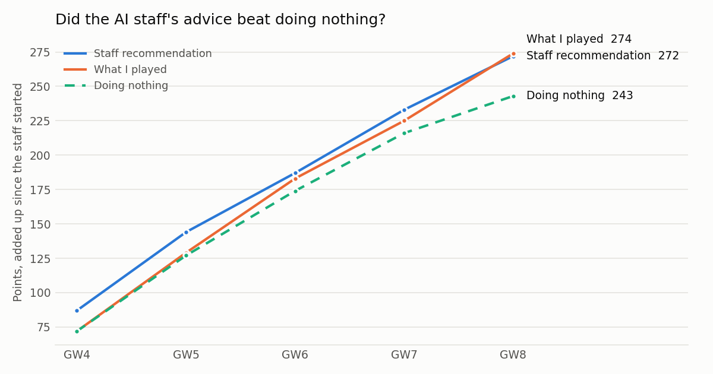
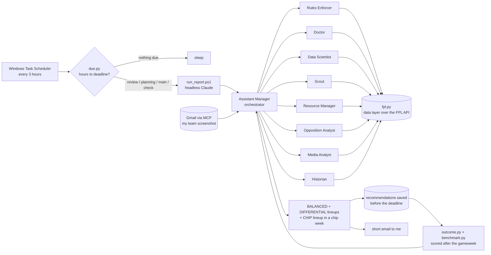

# A Multi-Agent AI Staff for Fantasy Premier League

**Can a team of AI agents help me improve in FPL?**

Every gameweek in Fantasy Premier League (FPL) brings the same decisions: which 11 of my 15 players start, who is captain, whether to make transfers, and when to play a chip. I play in a four-manager league with friends. Instead of deciding alone, I built a **multi-agent AI system** that works like a real football staff. Before every deadline, nine LLM agents read live data, argue, and email me two lineups. **The AI only advises; I make every change myself.**

The system runs by itself through the season, and every recommendation is checked against what actually happened. That way the question above gets a measured answer instead of a feeling.



## Findings

<!-- RESULTS:START -->
| GW | Staff advice | What I played | Doing nothing | Score /10 | vs top-100 avg | World rank |
|---|---|---|---|---|---|---|
| 4 | 87 | 72 | 72 | 6.0 | -28 | 6.62M |
| 5 | 57 | 57 | 55 | 8.0 | -3 | 5.76M |
| 6 | 43 | 54 | 47 | 4.1 | -29 | 5.89M |
| 7 | 46 | 42 | 42 | 1.4 | -43 | 6.80M |
| 8 | 39 | 49 | 27 | 8.3 | -10 | 6.60M |
| **Total** | **272** | **274** | **243** | | | |

Over GW4-8 the staff's recommended lineups scored **+12%** against doing nothing. It is a small sample, so read it as an early sign, not proof.
<!-- RESULTS:END -->

**Scores.** *Staff advice*, *What I played* and *Doing nothing* are points over the gameweek, auto-substitutions applied. *Score /10* is the share of all ~11 million FPL managers I beat that week. *vs top-100 avg* compares me with the average of the world's current top 100 managers.

## How it works



Everything is timed from the **deadline**, not the weekday, because some deadlines fall midweek. A scheduler wakes every 3 hours. A small Python file (`due.py`, no AI) decides whether one of four runs is due:

| Run | When | What it does |
|---|---|---|
| **Review** | once the gameweek's data is final | scores last week's advice against what happened and updates the season plan |
| **Planning** | 4 to 2 days before | chip timing, the season plan, the expected moves of the three rivals, and two checkable goals for the week |
| **Main** | about 1 day before | reads my emailed team through the **Gmail MCP connector**, runs the staff meeting, and emails two lineups (three in a chip week) |
| **Check** | last 8 hours | re-checks fitness and whether the report really arrived; silent unless something is wrong |

Each run starts Claude **headlessly** (`claude -p`, no chat window, nobody watching). It does the work and emails me the result.

### The staff

Each agent is one file in [`.claude/agents/`](.claude/agents/) that sets its role, the tools it may use and its model. The orchestrator runs on Claude Fable and the specialists on Claude Opus.

| Agent | How it does its job |
|---|---|
| **Assistant Manager** | The orchestrator. Calls the specialists in order, makes them answer each other instead of averaging, and builds the lineups. |
| Rules Enforcer | Checks every lineup is legal, owns the chip calendar, and rebuilds every manager's free transfers from their history. |
| Doctor | Reads FPL's injury flags, then searches press conferences, because the official flags lag by hours. |
| Data Scientist | Works from xG, xA, per-90 numbers and real team strength, and distrusts FPL's own "expected points". |
| Scout | The human read on role, tactics and form. A deliberate counterweight to the Data Scientist. |
| Resource Manager | Free transfers, money, selling prices, price changes. An unused resource needs a stated reason. |
| Opposition Analyst | Downloads the three rivals' teams, predicts their moves, and decides where to copy them and where to differ. |
| Media Analyst | Downloads the world top 100 managers' teams every week and tracks how they play the season. |
| Historian | The memory. Keeps a ledger of every decision, judged on what was knowable *before* the deadline, not on luck. |

[`CLAUDE.md`](CLAUDE.md) is the shared rulebook every agent reads first. Most of its rules exist because something broke and had to be fixed.

### The data layer

Agents never call the FPL API directly. [`fpl.py`](fpl.py) wraps the official **REST API** with a disk cache, so all nine agents argue from one snapshot of the facts. The analysis tools sit on top of it:

| File | What it measures |
|---|---|
| [`fpl.py`](fpl.py) | players, fixtures, live points, managers' teams, real team strength |
| [`elite.py`](elite.py) | what the world top 100 own, and how they play the season (transfers, hits, captains, chips) |
| [`chipcalc.py`](chipcalc.py) | what each chip is worth in points, gameweek by gameweek |
| [`gap.py`](gap.py), [`league_status.py`](league_status.py) | the gap to each rival, and every manager's transfers, free transfers and chips left |
| [`lineup.py`](lineup.py) | the FPL-style pitch pictures in every email |

## How it is evaluated

An AI system that is never checked teaches nothing, so evaluation is built in:

1. **Pre-registration.** Before the deadline, every lineup offered is saved exactly as it was offered, with its predicted points and best and worst case ([`outcome.py`](outcome.py)).
2. **Scoring.** After the gameweek, the real result is downloaded and each option is scored with chips applied. Scoring refuses to run before the deadline, because the API would still return last week's team.
3. **Baselines.** Each result is compared with **doing nothing**, the **top-100 average**, the **world average** and FPL's **Team of the Week** as the ceiling ([`benchmark.py`](benchmark.py)).
4. **Process, not luck.** The Historian judges each decision right, wrong, unlucky or too early, based only on what was knowable at the time.
5. **Feedback.** Every report must name one thing done differently because of a past mistake. Each week's two goals are marked met or missed.

## Honest limits

- **Small sample.** A few gameweeks of noisy football points are early signs, not proof.
- **Not a controlled experiment.** I read the advice before making my own choices.
- **No trained model yet.** The intelligence is LLM reasoning over data plus hand-built metrics. A points-prediction model the agents can call as a tool is the natural next step.
- **Web search, not a curated knowledge base.** A RAG layer over press conferences would let the agents cite their sources.

## Privacy

This repository is a public copy of a private working folder. The other managers appear only by their team names. My entry and league IDs, my email setup and the decision notes stay private (see `config.example.json`). Results are refreshed each gameweek by [`export_results.py`](export_results.py) and published only after I approve them.

## How to run

Python 3.10+ with `requests`, `matplotlib` and `numpy`, plus [Claude Code](https://claude.com/claude-code) for the agents.

```bash
pip install requests matplotlib numpy
cp config.example.json config.json      # your FPL entry ID and league ID
python fpl.py status                    # current gameweek and deadline
python gap.py                           # the gap to each rival
python elite.py refresh                 # what the world top 100 own and how they play
```

The scheduled reports run through `schedule.ps1` (Windows Task Scheduler) → `dispatch.ps1` → `run_report.ps1`.

## Tools

Python · Claude Code · LLM agents (Claude Fable, Opus) · Multi-agent orchestration · MCP · REST APIs · Windows Task Scheduler · Matplotlib

## Background

Built in September–October 2026 by **Ido Shalom** with Claude Code as a coding partner. I designed the system: the agent roles, the rules, the data it uses and how it is evaluated.
